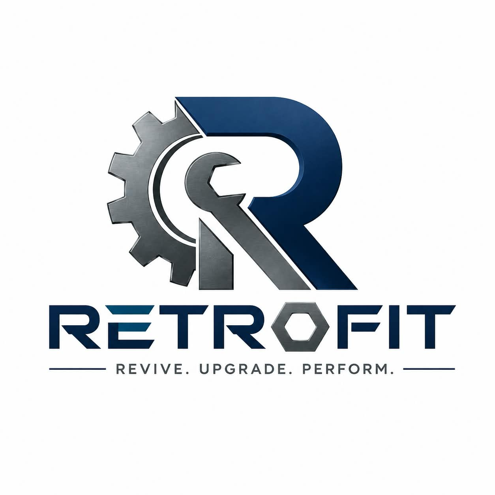
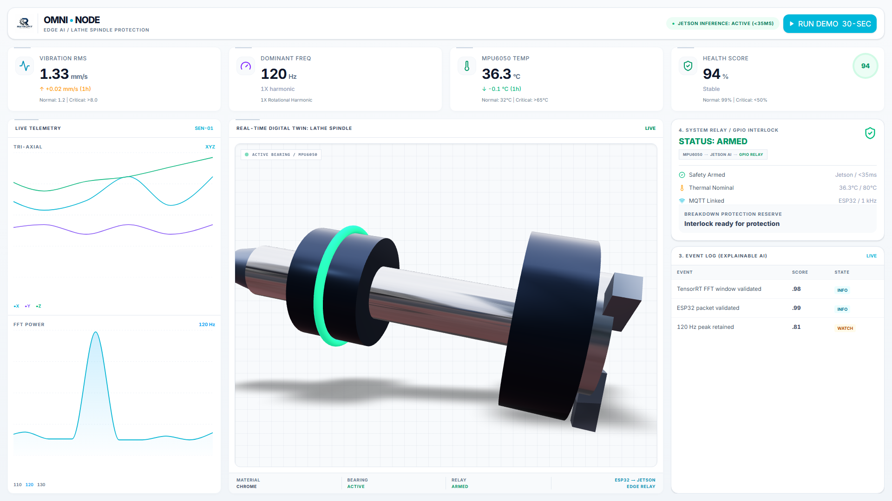
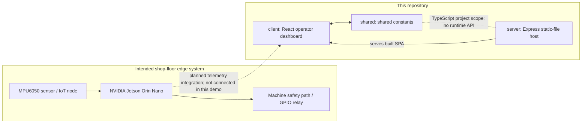

<div align="center">
  
  <br />
  
  <h1>OMNI-NODE – Industrial Intelligence</h1>
  <p>Edge-AI machine insight and spindle protection for high-mix, low-volume manufacturing.</p>
  <p>
    
    
    
    
    
    
  </p>
</div>

## Overview

OMNI-NODE is the operator-dashboard component of the Omni-Node non-invasive retrofit concept for MSME high-mix, low-volume (HMLV) job shops. The broader ecosystem is intended to bring Industry 4.0 capabilities to legacy CNC machinery using wireless sensor nodes and edge AI—supporting predictive maintenance, "Show-and-Learn" kinesthetic teaching, and fast autonomous safety interventions.

This repository currently provides a responsive spindle-monitoring interface and a browser-side machine-state demonstration. The telemetry and safety transitions are simulated in the client; the repository does not yet ingest sensor data, communicate with a Jetson or relay, or implement an application telemetry API. Hardware names and safety timings shown in the UI describe the target ecosystem and are not evidence of a live hardware connection.

## Dashboard Preview

The operator-interface screenshot is displayed in the centered header immediately after the logo. It shows the 3D spindle digital twin, tri-axial vibration telemetry, and safety-path panels. To refresh it, run the dashboard locally, capture the running interface, and replace `docs/dashboard-preview.png`.

## System Architecture

The hardware path below represents the intended retrofit ecosystem. The web application is currently a simulation/demo: the dashed link is not an implemented telemetry connection.



In the deployed concept, edge processing would analyze machine signals and provide evidence for operator decisions and protective actions. In the current code, `client/src/hooks/useMachineSimulation.ts` generates demo values in the browser, and `server/index.ts` serves the built frontend with a client-side route fallback. It does not expose machine telemetry or control endpoints.

## Features

### Implemented in this repository

- Responsive operator dashboard with KPI cards for vibration RMS, dominant frequency, MPU6050 temperature, and machine health.
- Three.js / React Three Fiber lathe-spindle visualization with bearing-state colors and an animated critical-state indicator.
- Browser-simulated tri-axial and FFT charts that update once per second.
- A 30-second demonstration with healthy, degradation, and critical phases; an event log; and a protective-stop modal with an acknowledge/reset action.
- Safety-path and relay-status panels that visually show the MPU6050 → Jetson AI → GPIO relay concept.
- Express static hosting and a fallback for frontend routes.

The sensor values, health score, event evidence, MQTT/relay labels, and protective-stop result in the current UI are demonstration content; no physical sensor, MQTT broker, Jetson, or GPIO relay is connected by this code.

### Roadmap and design context

`todo.md` records its listed UI, responsive-layout, simulation, and handoff tasks as complete. `ideas.md` captures visual and interaction design decisions, rather than an open issue list. The broader ecosystem goals—real wireless sensor ingestion, edge-AI integration, verified relay control, and "Show-and-Learn" teaching—are not implemented in the current app and should be treated as future integration work, not existing dashboard features.

## Tech Stack

| Area | Technology | Declared version |
| --- | --- | --- |
| Language | TypeScript | `5.6.3` |
| UI | React / React DOM | `^19.2.1` |
| Build and development server | Vite | `^7.1.7` |
| Server runtime | Node.js | `20+` recommended by `LOCAL_SETUP.md` |
| HTTP/static server | Express | `^4.21.2` |
| Styling | Tailwind CSS / Vite plugin | `^4.1.14` / `^4.1.3` |
| 3D visualization | Three.js, React Three Fiber, Drei | `^0.179.1`, `^9.7.0`, `^10.7.8` |
| Charts | Recharts | `^2.15.2` |
| UI components | Radix UI, shadcn/ui conventions, Lucide React | Radix versions listed in `package.json`; `lucide-react ^0.453.0` |
| Routing / animation | Wouter / Framer Motion | `^3.3.5` / `^12.23.22` |
| Validation / forms | Zod, React Hook Form | `^4.1.12` / `^7.64.0` |

Version values above are the versions/ranges declared in `package.json`; caret (`^`) ranges are not pinned exact installations. The package manager metadata specifies pnpm `10.4.1`.

The complete declared dependency ranges are listed below. `package.json` and the lockfiles remain the source of truth for installation.

<details>
<summary>All runtime dependencies</summary>

```text
@hookform/resolvers ^5.2.2
@radix-ui/react-accordion ^1.2.12
@radix-ui/react-alert-dialog ^1.1.15
@radix-ui/react-aspect-ratio ^1.1.7
@radix-ui/react-avatar ^1.1.10
@radix-ui/react-checkbox ^1.3.3
@radix-ui/react-collapsible ^1.1.12
@radix-ui/react-context-menu ^2.2.16
@radix-ui/react-dialog ^1.1.15
@radix-ui/react-dropdown-menu ^2.1.16
@radix-ui/react-hover-card ^1.1.15
@radix-ui/react-label ^2.1.7
@radix-ui/react-menubar ^1.1.16
@radix-ui/react-navigation-menu ^1.2.14
@radix-ui/react-popover ^1.1.15
@radix-ui/react-progress ^1.1.7
@radix-ui/react-radio-group ^1.3.8
@radix-ui/react-scroll-area ^1.2.10
@radix-ui/react-select ^2.2.6
@radix-ui/react-separator ^1.1.7
@radix-ui/react-slider ^1.3.6
@radix-ui/react-slot ^1.2.3
@radix-ui/react-switch ^1.2.6
@radix-ui/react-tabs ^1.1.13
@radix-ui/react-toggle ^1.1.10
@radix-ui/react-toggle-group ^1.1.11
@radix-ui/react-tooltip ^1.2.8
@react-three/drei ^10.7.8
@react-three/fiber ^9.7.0
axios ^1.12.0
class-variance-authority ^0.7.1
clsx ^2.1.1
cmdk ^1.1.1
embla-carousel-react ^8.6.0
express ^4.21.2
framer-motion ^12.23.22
input-otp ^1.4.2
lucide-react ^0.453.0
nanoid ^5.1.5
next-themes ^0.4.6
react ^19.2.1
react-day-picker ^9.11.1
react-dom ^19.2.1
react-hook-form ^7.64.0
react-resizable-panels ^3.0.6
recharts ^2.15.2
sonner ^2.0.7
streamdown ^1.4.0
tailwind-merge ^3.3.1
tailwindcss-animate ^1.0.7
three ^0.179.1
vaul ^1.1.2
wouter ^3.3.5
zod ^4.1.12
```
</details>

<details>
<summary>All development dependencies</summary>

```text
@builder.io/vite-plugin-jsx-loc ^0.1.1
@tailwindcss/typography ^0.5.15
@tailwindcss/vite ^4.1.3
@types/express 4.17.21
@types/google.maps ^3.58.1
@types/node ^24.7.0
@types/react ^19.2.1
@types/react-dom ^19.2.1
@types/three ^0.179.0
@vitejs/plugin-react ^5.0.4
add ^2.0.6
autoprefixer ^10.4.20
esbuild ^0.25.0
pnpm ^10.15.1
postcss ^8.4.47
prettier ^3.6.2
tailwindcss ^4.1.14
tsx ^4.19.1
tw-animate-css ^1.4.0
typescript 5.6.3
vite ^7.1.7
vite-plugin-manus-runtime ^0.0.58
vitest ^2.1.4
```
</details>

## Project Structure

```text
omni-node-dashboard/
├── client/
│   ├── index.html
│   ├── public/
│   │   ├── __manus__/
│   │   │   └── debug-collector.js
│   │   └── logo.jpeg
│   └── src/
│       ├── App.tsx
│       ├── const.ts
│       ├── index.css
│       ├── main.tsx
│       ├── components/
│       │   ├── ErrorBoundary.tsx
│       │   ├── EventLog.tsx
│       │   ├── MachineSpindle.tsx
│       │   ├── ManusDialog.tsx
│       │   ├── Map.tsx
│       │   ├── SafetyControl.tsx
│       │   ├── TelemetryCharts.tsx
│       │   └── ui/
│       │       ├── accordion.tsx
│       │       ├── alert-dialog.tsx
│       │       ├── alert.tsx
│       │       ├── aspect-ratio.tsx
│       │       ├── avatar.tsx
│       │       ├── badge.tsx
│       │       ├── breadcrumb.tsx
│       │       ├── button-group.tsx
│       │       ├── button.tsx
│       │       ├── calendar.tsx
│       │       ├── card.tsx
│       │       ├── carousel.tsx
│       │       ├── chart.tsx
│       │       ├── checkbox.tsx
│       │       ├── collapsible.tsx
│       │       ├── command.tsx
│       │       ├── context-menu.tsx
│       │       ├── dialog.tsx
│       │       ├── drawer.tsx
│       │       ├── dropdown-menu.tsx
│       │       ├── empty.tsx
│       │       ├── field.tsx
│       │       ├── form.tsx
│       │       ├── hover-card.tsx
│       │       ├── input-group.tsx
│       │       ├── input-otp.tsx
│       │       ├── input.tsx
│       │       ├── item.tsx
│       │       ├── kbd.tsx
│       │       ├── label.tsx
│       │       ├── menubar.tsx
│       │       ├── navigation-menu.tsx
│       │       ├── pagination.tsx
│       │       ├── popover.tsx
│       │       ├── progress.tsx
│       │       ├── radio-group.tsx
│       │       ├── resizable.tsx
│       │       ├── scroll-area.tsx
│       │       ├── select.tsx
│       │       ├── separator.tsx
│       │       ├── sheet.tsx
│       │       ├── sidebar.tsx
│       │       ├── skeleton.tsx
│       │       ├── slider.tsx
│       │       ├── sonner.tsx
│       │       ├── spinner.tsx
│       │       ├── switch.tsx
│       │       ├── table.tsx
│       │       ├── tabs.tsx
│       │       ├── textarea.tsx
│       │       ├── toggle-group.tsx
│       │       ├── toggle.tsx
│       │       └── tooltip.tsx
│       ├── contexts/
│       │   └── ThemeContext.tsx
│       ├── hooks/
│       │   ├── useComposition.ts
│       │   ├── useMachineSimulation.ts
│       │   ├── useMobile.tsx
│       │   └── usePersistFn.ts
│       ├── lib/
│       │   └── utils.ts
│       └── pages/
│           ├── Home.tsx
│           └── NotFound.tsx
├── docs/
│   └── dashboard-preview.png
├── patches/
│   └── wouter@3.7.1.patch
├── server/
│   └── index.ts
├── shared/
│   └── const.ts
├── .gitignore
├── .prettierignore
├── .prettierrc
├── components.json
├── ideas.md
├── LOCAL_SETUP.md
├── package-lock.json
├── package.json
├── pnpm-lock.yaml
├── template.json
├── todo.md
├── tsconfig.json
├── tsconfig.node.json
└── vite.config.ts
```

`client/src/components/ui/` contains the reusable UI component set. `shared/const.ts` currently exports shared constants; it is not a telemetry protocol or API layer.

## Prerequisites and Local Setup

Use Node.js 20 or later. pnpm `10.4.1` is the package manager configured by this repository; `LOCAL_SETUP.md` recommends installing from the root using the frozen pnpm lockfile.

### pnpm (recommended)

```bash
corepack enable
corepack prepare pnpm@10.4.1 --activate
pnpm install --frozen-lockfile
pnpm check
pnpm dev
```

Vite listens on port `3000` by default, binds to available network interfaces (`--host`), and selects the next available port if `3000` is busy.

### npm alternative

The repository also includes `package-lock.json`; you can use npm instead:

```bash
npm ci
npm run check
npm run dev
```

### Production build and start

Both package scripts build the static frontend into `dist/public` and bundle the Express server into `dist/index.js`. On POSIX shells:

```bash
pnpm build
pnpm start
```

The `start` script sets `NODE_ENV=production` using POSIX shell syntax. In Windows PowerShell, use the built server directly after building:

```powershell
pnpm build
$env:NODE_ENV = "production"
node dist/index.js
```

The production server listens on `PORT`, or `3000` when `PORT` is unset.

## Environment Variables

No `.env` file is committed. Vite loads variables from the repository root (`envDir` in `vite.config.ts`). The following variables are referenced by the source/configuration:

| Variable | Used by | Purpose / behavior |
| --- | --- | --- |
| `PORT` | `server/index.ts` | Express listening port; defaults to `3000`. |
| `NODE_ENV` | `server/index.ts`, `vite.config.ts` | Selects production static-file path and disables development debug-collector injection in production. |
| `BUILT_IN_FORGE_API_URL` | Vite storage proxy in `vite.config.ts` | Base URL used by the development `/manus-storage` proxy. |
| `BUILT_IN_FORGE_API_KEY` | Vite storage proxy in `vite.config.ts` | Bearer credential for that proxy. Keep server-side; do not expose it through a `VITE_` variable. |
| `VITE_OAUTH_PORTAL_URL` | `client/src/const.ts` | Base URL used by the login-URL helper. |
| `VITE_APP_ID` | `client/src/const.ts` | Application ID passed to the login-URL helper. |
| `VITE_FRONTEND_FORGE_API_KEY` | `client/src/components/Map.tsx` | Key placed in the Google Maps proxy script URL if the map component is used. Client-exposed `VITE_` values are bundled into browser code. |
| `VITE_FRONTEND_FORGE_API_URL` | `client/src/components/Map.tsx` | Optional frontend Forge base URL for the map proxy; defaults to `https://forge.butterfly-effect.dev`. |

The login helper and map component exist in the source, but are not part of the current dashboard page flow. No environment values are required to run the default simulated dashboard.

## Package Scripts

| Script | Command | Purpose |
| --- | --- | --- |
| `dev` | `vite --host` | Start the Vite development server. |
| `build` | `vite build && esbuild server/index.ts --platform=node --packages=external --bundle --format=esm --outdir=dist` | Build the frontend and bundle the server entry point. |
| `start` | `NODE_ENV=production node dist/index.js` | Run the built Express server in production mode. |
| `preview` | `vite preview --host` | Serve the built frontend using Vite's preview server. |
| `check` | `tsc --noEmit` | Type-check without emitting compiled files. |
| `format` | `prettier --write .` | Format repository files with Prettier. |

## License and Acknowledgments

This project is licensed under the **MIT License**, as declared by `package.json`. The dashboard uses the open-source libraries listed in the Tech Stack and dependency manifest, including React, Vite, Express, Tailwind CSS, Three.js, React Three Fiber, Recharts, Radix UI, and Lucide.
